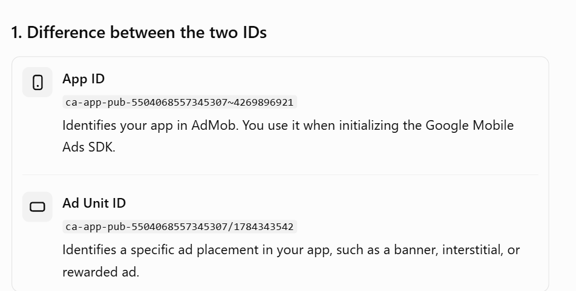

import 'package:flutter/material.dart';
import 'package:google_mobile_ads/google_mobile_ads.dart';

Future<void> main() async {
WidgetsFlutterBinding.ensureInitialized();

await MobileAds.instance.initialize();

runApp(const MyApp());
}

Add the AdMob App ID
Open AndroidManifest.xml. Inside the existing <application> tag, add the following code:

<application
android:label="your_app_name"
android:name="${applicationName}"
android:icon="@mipmap/ic_launcher">

    <meta-data
        android:name="com.google.android.gms.ads.APPLICATION_ID"
        android:value="ca-app-pub-3940256099942544~3347511713"/>

    <!-- Keep your existing activity and other settings here -->

</application>

Notice the key difference:

The App ID contains a ~ (tilde) before the final number.
The Ad Unit ID contains a / (slash) before the final number.

AndroidManifest.xml — SDK configuration -App ID (~)
Banner ad code — loading/displaying ads -Ad Unit ID (/)

Banner Ad — displayed at the top or bottom of a screen.
Interstitial Ad — full-screen ad between screens or actions.
Rewarded Ad — users watch an ad to earn a reward.
Rewarded Interstitial Ad — full-screen ad with a reward.
Native Ad — an ad styled to fit your app's UI.
App Open Ad — shown when the app opens or returns to the foreground.

-for Ios
ios/Runner/Info.plist
Inside the main <dict> section, add:
<key>GADApplicationIdentifier</key>
<string>ca-app-pub-3940256099942544~1458002511</string>