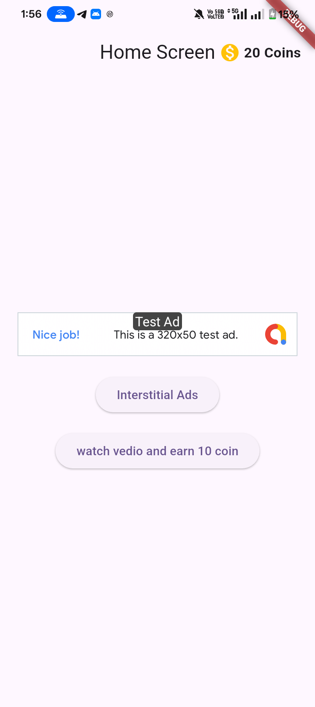
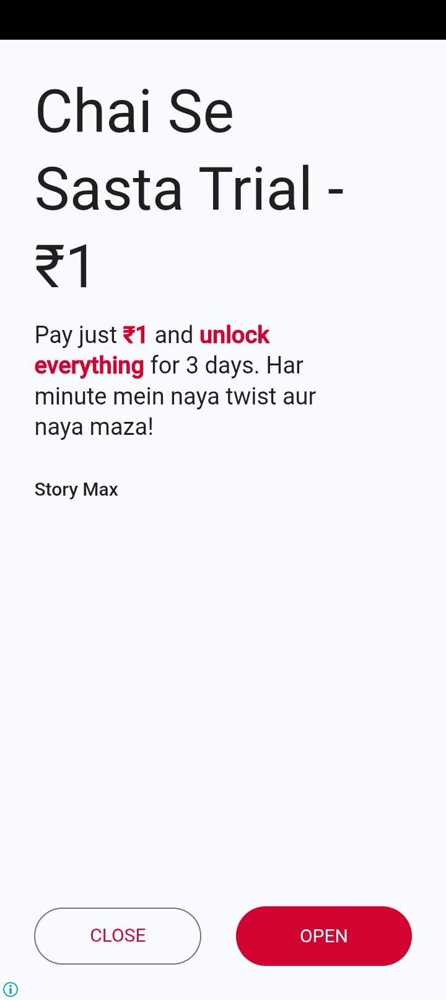
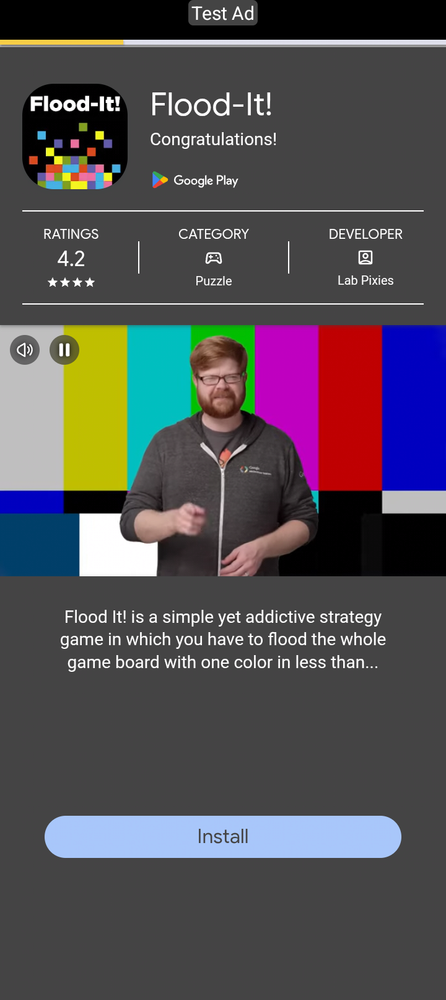
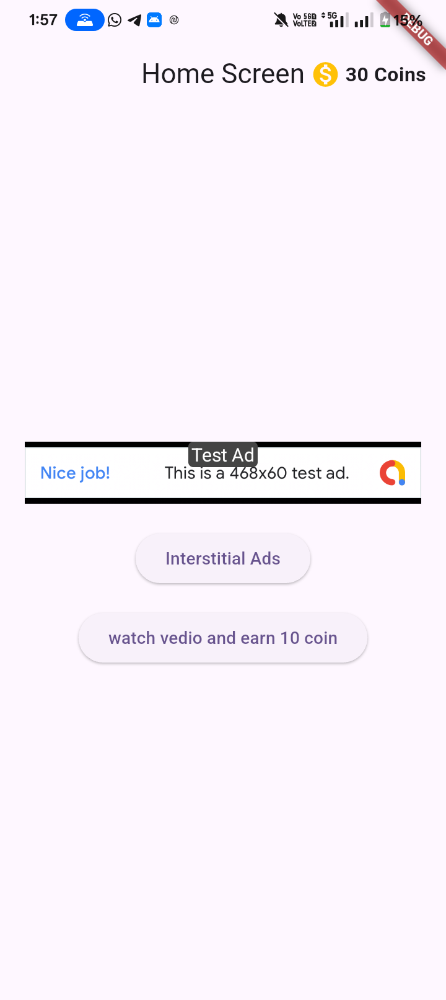

# Flutter AdMob (Google Mobile Ads) Integration

A clean, modern, and production-ready Flutter project demonstrating complete integration of **Google Mobile Ads (AdMob)**, including **Banner Ads**, **Interstitial Ads**, and **Rewarded Video Ads** paired with an in-app **Coin Reward Economy**.

---

## 🚀 Features

- 🪙 **Coin Economy System**: Live coin counter displayed in the Header Bar (`AppBar`), dynamically updating when rewarded ads are watched.
- 🎬 **Rewarded Video Ads**: Managed via `RewardedAdManager` — rewards users with **+10 coins** upon completing a video ad.
- 🖼️ **Banner Ads**: Custom `BannerAdWidget` for clean inline ad rendering.
- ⏹️ **Interstitial Ads**: Managed full-screen ads via `InterstitialAdManager`.
- ⚙️ **Centralized Ad Helper**: Clean `AdHelper` supporting platform-specific (Android & iOS) Ad Unit IDs.

---

## 📁 Project Structure

```
lib/
├── add_helper/
│   └── ad_helper.dart             # Centralized Ad Unit IDs for Android & iOS
├── ads/
│   ├── banner_ad_widget.dart      # Banner Ad Widget component
│   ├── interstitial_ad_manager.dart # Interstitial Ad controller
│   └── rewarded_ad_manager.dart   # Rewarded Video Ad controller
├── home_screen.dart               # Main UI screen with Coin Header & Ad triggers
└── main.dart                      # MobileAds initialization & App entry point
```

---

## 🛠️ Mobile Ads Configuration

### 1. Flutter Initialization (`main.dart`)

Initialize the Google Mobile Ads SDK before running the app:

```dart
import 'package:flutter/material.dart';
import 'package:google_mobile_ads/google_mobile_ads.dart';

Future<void> main() async {
  WidgetsFlutterBinding.ensureInitialized();
  await MobileAds.instance.initialize();
  runApp(const MyApp());
}
```

---

### 2. Android Configuration (`AndroidManifest.xml`)

Add your AdMob Application ID inside the `<application>` tag of `android/app/src/main/AndroidManifest.xml`:

```xml
<manifest xmlns:android="http://schemas.android.com/apk/res/android">
    <application
        android:label="ads_test"
        android:name="${applicationName}"
        android:icon="@mipmap/ic_launcher">

        <!-- AdMob App ID (Use Test ID during development) -->
        <meta-data
            android:name="com.google.android.gms.ads.APPLICATION_ID"
            android:value="ca-app-pub-3940256099942544~3347511713"/>

    </application>
</manifest>
```


---

### 3. iOS Configuration (`Info.plist`)

Add your AdMob Application ID inside the `<dict>` tag of `ios/Runner/Info.plist`:

```xml
<key>GADApplicationIdentifier</key>
<string>ca-app-pub-3940256099942544~1458002511</string>
```

---

## ⚠️ Key Concept: App ID vs Ad Unit ID

It is critical to distinguish between your **AdMob App ID** and individual **Ad Unit IDs**:

| Type | Format Character | Example | Usage Location |
| :--- | :---: | :--- | :--- |
| **App ID** | `~` (tilde) | `ca-app-pub-3940256099942544~3347511713` | Manifest / Info.plist |
| **Ad Unit ID** | `/` (slash) | `ca-app-pub-3940256099942544/5224354917` | Flutter Code (`AdHelper`) |






---

## 📊 Supported Ad Formats

- 📌 **Banner Ad**: Displayed inline at the top or bottom of a screen.
- ⏹️ **Interstitial Ad**: Full-screen ad shown during natural app transitions.
- 🎁 **Rewarded Ad**: Full-screen video ad where users earn rewards (e.g., +10 coins) for watching.
- 🏅 **Rewarded Interstitial Ad**: Full-screen ad format that rewards users without forcing explicit opt-in.
- 🎨 **Native Ad**: Styled component that blends into your app's native layout.
- 🚪 **App Open Ad**: Shown when users open or return to the app from the background.

---

## 💡 How to Run the App

1. **Install Flutter Dependencies**:
   ```bash
   flutter pub get
   ```

2. **Run on a Device / Emulator**:
   ```bash
   flutter run
   ```

---

## 📜 Summary of Implemented Features

- [x] **AdMob SDK Initialized**: `MobileAds.instance.initialize()`
- [x] **Header Coin Tracker**: `AppBar` actions featuring a coin icon and live coin count
- [x] **Rewarded Ads Manager**: Video ad loading, reward callback (+10 coins), and auto-reloading
- [x] **Interstitial Ads Manager**: Full-screen interstitial display and callback lifecycle
- [x] **Banner Ad Component**: Inline banner ad integration
- [x] **Centralized Ad Helper**: Managed Android and iOS test IDs
